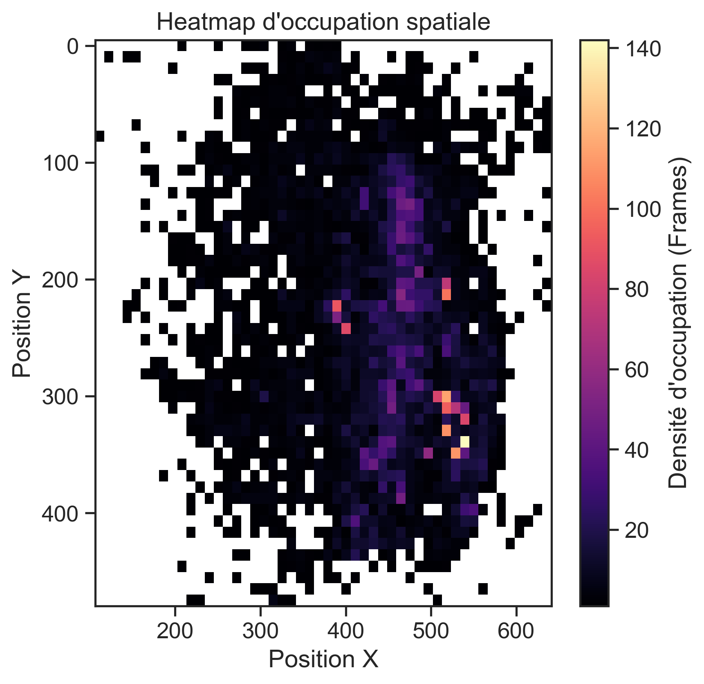

#  Automated Behavior Tracking & Unsupervised Pattern Discovery

##  Contexte du Projet
Ce projet implémente un pipeline complet de **Data Science** pour automatiser l'analyse du comportement animal. À partir de vidéos brutes, nous utilisons l'intelligence artificielle pour extraire des coordonnées spatiales, nettoyer les données et découvrir automatiquement des patterns comportementaux (syllabes motrices) sans biais humain.

Ce travail démontre une capacité à traiter des données biomédicales complexes et à les transformer en insights analytiques exploitables.

##  Stack Technique
* **Computer Vision :** DeepLabCut (Réseaux de neurones convolutifs)
* **Traitement de Données :** Python (Pandas, NumPy, Scikit-Learn)
* **Data Visualization :** Matplotlib, Seaborn
* **Méthodologie :** Analyse de séries temporelles, filtrage de signaux, clustering comportemental.

##  Pipeline d'Analyse
Le traitement est structuré en trois étapes clés :
1. **Extraction (DeepLabCut) :** Tracking des coordonnées (X, Y) des points d'intérêt (museau, dos, queue).
2. **Nettoyage & Feature Engineering :** Application de filtres de vraisemblance, lissage des trajectoires et calcul de métriques cinématiques (vitesse, orientation, étirement corporel).
3. **Modélisation :** Analyse de l'occupation spatiale (Heatmaps) et projection vectorielle pour identifier la direction de l'attention du sujet.

## Résultats Clés
* **Heatmaps :** Visualisation de la densité d'occupation spatiale.
* **Cinématique :** Profils de vélocité lissés permettant la classification automatique des états de mouvement.
* **Analyse directionnelle :** Reconstruction vectorielle de l'orientation de la tête.

## Comment lancer ce projet
1. Clonez ce dépôt : `git clone https://github.com/ton-pseudo/Automated-Behavior-Tracking.git`
2. Installez les dépendances : `pip install pandas numpy matplotlib seaborn`
3. Placez vos fichiers `.csv` (issus de DeepLabCut) dans le dossier `/data`.
4. Ouvrez le notebook `Pipeline_Analyse_Comportementale.ipynb` dans Jupyter.

### Aperçu des résultats

  
  

